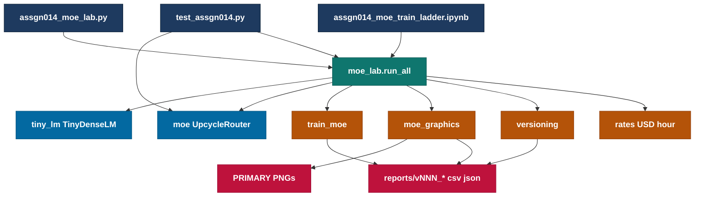
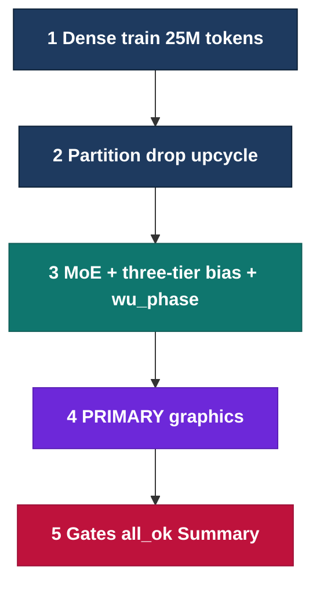
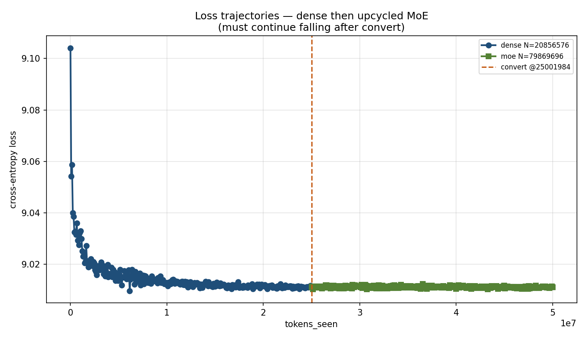
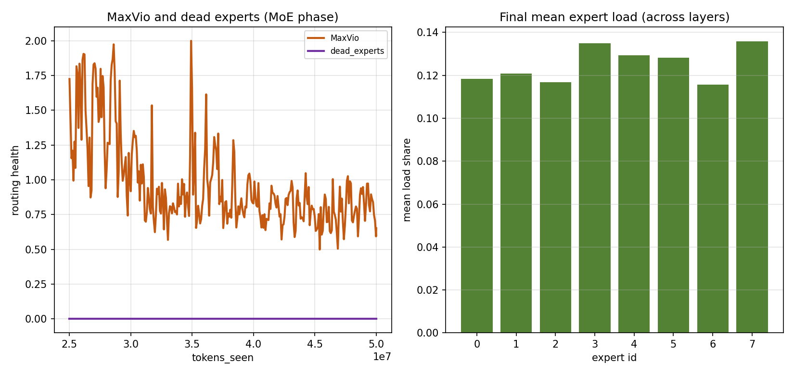
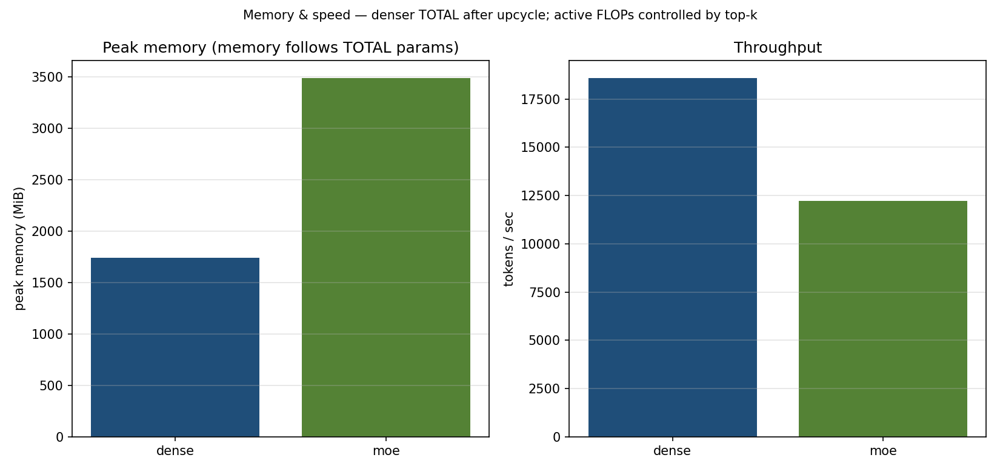

# Assign_0014 — Dense → MoE Upcycling 

Train a **~20.9M dense** decoder, **convert** FFNs to MoE (partition/drop), continue training with **loss-free three-tier bias** + probabilistic warm-up, and prove continued loss drop with **PRIMARY graphics**. Graded host: **Google Colab Tesla T4**.

> **Graded PASS: `v018_colab_t4_50m_full_wu_phase`** — `all_ok=True`, `dead_experts=0`, MaxVio≈0.65, effective warm-up 6104 steps.  
> **FAIL contrast: `v015_…_wu2k`** — fixed 2000-step warm-up ended mid full MoE phase → collapse (dead=6).

**Takeaway:** On synthetic data, late CE sits near `ln(8192)≈9.011`. The MoE claim is **routing health + loss not worse after convert**, not a large absolute CE drop. Phase-scaled warm-up (`wu_phase`) is required for full 25M+25M.

---

## High-level architecture



## Lab process



---

## 1. What this lab proves

```text
Dense CE falls (~21M TinyDenseLM)
  -> upcycle FFN to MoE (partition/drop, FP32 router, CE-aux OFF)
  -> probabilistic warm-up covers MoE phase (floor 2000; full ~6104)
  -> three-tier loss-free bias; MoE CE not worse after convert
  -> MaxVio bounded; dead experts = 0 on full
  -> 3 PRIMARY PNGs under reports/vNNN_host_gpu_budget_kind_tag
```

| Claim | Lab verb | Not this lab |
| :--- | :--- | :--- |
| Dense→MoE convert + continued loss | partition/drop upcycle | sklearn Linear |
| Loss-free balancing | three-tier bias for top-k only | CE auxiliary load loss |
| Bigger total, controlled active | N_moe_total > N_dense | Multi-GPU EP all-to-all |

### Model shape (lab defaults)

| Piece | Value |
| :--- | :--- |
| Dense LM | ~20.9M (`n_embd=384`, `n_layer=10`, vocab 8192) |
| Experts | N=8, top-k=2, SwiGLU width ≈ dense_inner / k |
| MoE total / active | ~80M total / ~27M active |
| Optimizer | AdamW |
| Router | Linear, **FP32** |
| Load balance | Loss-free **three-tier bias** (CE-aux **OFF**) |
| Colab batch / seq | batch=8, seq_len=512 → 4096 tokens/step |

```text
TOTAL params  → memory / Adam state
ACTIVE params → FLOPs / token (top-k experts only)
warmup_steps_effective = max(floor, ceil(tokens_moe / tokens_per_step))
  floor=2000; full MoE ≈ 25e6/4096 ≈ 6104  (tag wu_phase)
CE floor (synthetic uniform IDs, V=8192): ln(8192) ≈ 9.011
```

**Report folders:** `vNNN_colab_t4_50m_full_wu_phase` — budget + recipe tag. Override via `ASSGN014_VERSION_TAG`. Older `…_wu2k` folders are history.

---

## 2. Data source

**No external corpus.** Same synthetic protocol as Assign_0013:

```text
tok = torch.randint(0, vocab_size, (batch, seq_len + 1), device=…)
# next-token CE on synthetic IDs — src/pipeline/train_moe.py
```

Token budgets are **tokens_seen**, not unique documents. Late loss near ~9.011 is the CE floor of uniform random IDs over vocab 8192 — expected, not a failed MoE by itself.

---

## 3. Empirical evaluation (`v018`)

A PASS lab writes CSV/JSON under a **versioned** `reports/vNNN_*` folder plus **three PRIMARY PNGs**. Every gate prints operands (never a naked `True`).

### 3.1 Graded full (25M dense + 25M MoE)

| Phase | tokens_seen | N | final / convert loss | notes |
| :--- | ---: | ---: | ---: | :--- |
| Dense | 25,001,984 | 20,856,576 | 9.011086 | convert marker |
| MoE (`wu_phase`) | 25,001,984 | 79,869,696 total / 26,785,536 active | 9.011027 | MaxVio 0.65, dead=0 |

```text
host=colab  gpu=Tesla T4  batch=8  seq_len=512
upcycle=partition_drop  n_experts=8  top_k=2
use_ce_aux=False  router_dtype=float32  use_three_tier=True
warmup_steps_floor=2000  warmup_steps_effective=6104  version_tag=wu_phase
usd_per_hour=0.12  (ASSGN014_USD_PER_HOUR)
```

| Recipe | Warm-up | Full outcome |
| :--- | :--- | :--- |
| `wu2k` (v015) | stop at 2000 of ~6104 | dead=6, FAIL |
| `wu_phase` (v018) | covers full MoE phase | dead=0, PASS |

### 3.2 PRIMARY PNGs







| Artifact | Role |
| :--- | :--- |
| `assgn014_loss_trajectories.png` | Dense then MoE; convert marker |
| `assgn014_expert_load_health.png` | MaxVio / dead / load bars |
| `assgn014_memory_speed_dashboard.png` | Peak MiB + tok/s |

Graphics are the primary proof. 

---

## 4. Verification gate (`v018`)

```text
n_ok=True  moe_bigger=True  token_ok=True  loss_ok=True
balance_ok=True  png_ok=True  opt_ok=True  aux_off=True  router_fp32=True
n_dense=20856576  n_moe_total=79869696  dead_experts=0.0  max_vio=0.65234375
loss_at_convert=9.011085510253906  final_moe_loss=9.011027336120605
smoke=False  primary_pngs=3  usd_per_hour=0.12
n_experts=8  top_k=2  use_ce_aux=False  router_dtype=float32
all_ok=True  (PASS if True; FAIL if False)
```

`all_ok` (full): dense N in range, MoE bigger, token budgets, loss not worse after convert, **dead_experts==0** and MaxVio≤2, 3 PRIMARY PNGs, AdamW, CE-aux OFF, router FP32.

Smoke also requires **dead_experts==0** (soft MaxVio slack). Do not climb the ladder on `all_ok` alone if dead>0.

**pytest** (`tests/test_assgn014.py`) proves wiring in `tmp_path`. (operands + PNGs on disk).

---

## 5. From Assign_0012 / Assign_0013

| Assign | Relation |
| :--- | :--- |
| **0012** | ERA lab culture: PRIMARY PNGs, gates with operands, Domain was DP/ZeRO simulation — not shared model code. |
| **0013** | Direct sibling scaffold: ~20.9M TinyLM, **synthetic `randint` tokens**, Colab T4 ladder, versioned `reports/vNNN_*`. A14 drops Euler/midpoint reversibility and adds dense→MoE upcycle + three-tier bias + phase-scaled warm-up. Dense N matches A13 (`20856576`). |

---

## 6. Extra docs → lab mapping

Session Extra pack (`Asgn_14_NLM_Extra`, literacy beside the repo) maps as:

| Topic | In this lab? |
| :--- | :--- |
| Three-tier bias controller | **Yes** (default on) |
| Probabilistic warm-up after clone/upcycle | **Yes** (auto-extends to MoE phase; floor 2000) |
| Drop-r / top-k sweeps | Optional literacy |

---

## 7. Quick start (local smoke)

```text
cd Asgn_0014
cp .env.example .env
pip install -r requirements.txt
python tests/assgn014_moe_lab.py --smoke --tokens-dense 4096 --tokens-moe 8192 --batch 2 --seq-len 128
python -m pytest tests/test_assgn014.py -q
```

Colab T4 defaults to **batch=8**. Full budgets (25M + 25M):

```text
python tests/assgn014_moe_lab.py --full --batch 8
```

---

## 8. Colab (ladder)

Same pattern as Assgn_013: unzip once, optional Drive, smoke → stepped budgets → zip-after-each → graded full.

1. Take all src, tests, notebook and create zip file.
2. Upload `Assign_0014_colab.zip` to **`/content/`**.
3. Open **`notebooks/assgn014_moe_train_ladder.ipynb`**.
4. Run Cell 0 (unzip to `/content/Assign_0014`) then Cell 1 (Drive or local `reports/`, **BATCH=8**).
5. Re-run **Smoke** after pulling bias/warm-up fixes — check dead_experts trending down.
6. Ladder (each step zips `/content/<version>.zip` — download before disconnect):

```text
Smoke   4k dense + 4k MoE     smoke=True
2M      1M + 1M               smoke=True
5M      2.5M + 2.5M           smoke=True
10M     5M + 5M               smoke=True
Full    25M + 25M             smoke=False  (RESUME after disconnect only)
```

7. Run the Diagnostics cell.

**Zip extract:** put files in `reports/<version>/` (manifest beside PNGs). Do not nest `v00N/v00N/`.

Do **not** RESUME across different budgets. Set `RESUME` only on the Full cell after a disconnect. Do not RESUME failed `v015_…_wu2k`.

(notebooks/assgn014_moe_train.ipynb) is optional one-shot smoke only.

---

## 9. Repository structure

```text
Asgn_0014/
  src/  tests/  notebooks/  configs/
  reports/v018_colab_t4_50m_full_wu_phase/   # CSV JSON PRIMARY PNGs
  reports/v015_colab_t4_50m_full_wu2k/       # FAIL contrast (optional keep)
  .env.example                               # real .env gitignored
```

Checkpoints under `reports/**/checkpoints/` and `*.pt` / report zips are gitignored

---

### Why identical expert clones collapse

1. **Upcycle** turns one dense FFN into many experts. If those experts start **identical**, they compute the same function for every token.

2. **Loss does not care** which expert runs — any of them gives the same output — so training never “needs” all of them.

3. The **router** picks top-k. Right after convert it is nearly random, and biases often start at zero, so tiny score noise decides the winners.

4. **Hard top-k** sends tokens (and gradients) only to the chosen experts. Losers get **no weight updates**.

5. Winners improve a little → keep winning → losers stay unused → **dead experts** and load piles onto a few favorites. That is collapse.

6. **Break the symmetry early:** partition/drop so experts are not clones; use **random exploration (Gumbel warm-up)** so losers still get tokens; use **loss-free bias** to push load toward even shares before hard top-k locks in.

---

### One-line summary

**Identical (or near-identical) experts make CE indifferent among them; hard top-k + random router then locks a few winners and starves the rest.** The code mitigates that by **partition+drop (r=0.5)**, then **Gumbel warm-up for the full MoE phase**, plus **three-tier bias**—which is why pure “8 identical clones + hard top-k from step 0” would collapse, and why ending warm-up early (v015) did.
