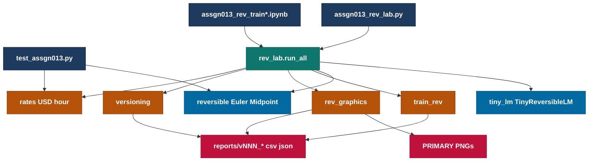
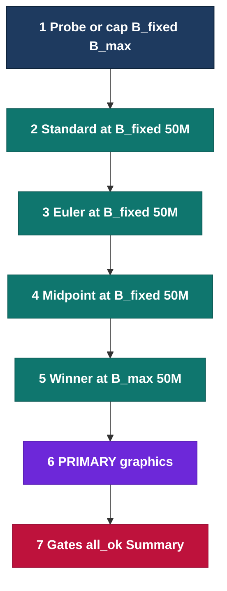
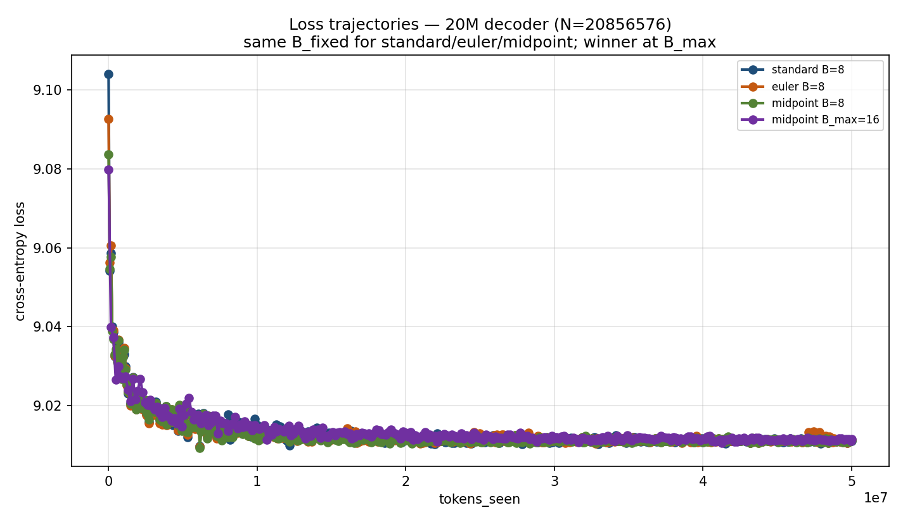
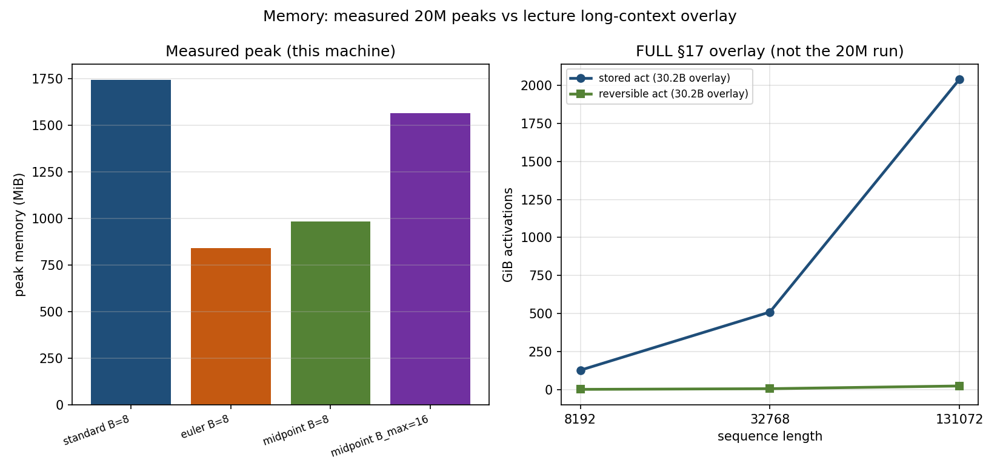
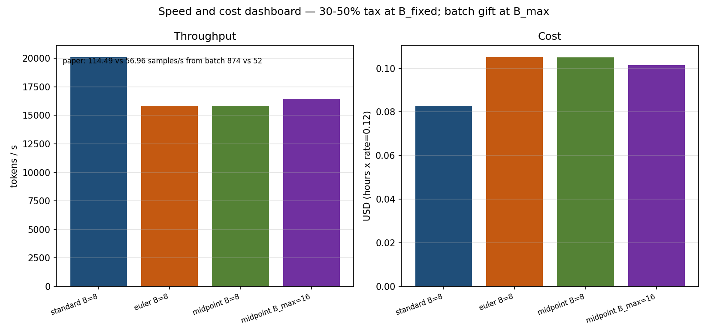

# Assign_0013 — Reversible 20M LLM (Session 13)

Train a **~20M** decoder for a **50M-token** budget on a single GPU (Colab T4 graded). Compare **standard** vs **Euler** vs **midpoint** at a fixed batch, pick the winner from the **loss trajectory**, then push batch on the winner. **Graphics are the primary proof.** Graded artifacts: `reports/v008_colab_t4_full/`.

> 🏆 **Winner: midpoint** — lower final_loss at `B_fixed=8` (9.0111 vs euler 9.0113); then trained at `B_max=16`.

**Takeaway:** Midpoint won the A/B; reversibility cut peak memory vs standard at the same batch (~21% tok/s tax); larger batch on the winner is the memory gift.

---

## High-level architecture



## Lab process



---

## 1. What this lab proves

```text
midpoint:  p_{l+1} = p_{l-1} + 2h · f_θ(p_l)
euler:     p_next  = p_curr  +  h · f_θ(p_curr)
AdamW state ≈ 16 bytes/param (param + grad + m + v, FP32 accounting)
Reversible: recompute activations in backward; dropout must be 0
h = 0.25; weight_decay = 0 on reversible path; optimizer = AdamW (not Muon)
N ≈ 20.86e6  (gate 18e6–22e6)
One run = tokens_seen ≥ 50e6  (not 50M unique documents)
```

| Claim | Lab verb | Not this lab |
| :--- | :--- | :--- |
| Reversibility saves activation memory vs depth | Euler + midpoint custom autograd | Gradient checkpointing labeled as reversible |
| Fair A/B at same batch | `B_fixed` for standard / euler / midpoint | Raising batch before the comparison |
| Memory gift | Winner only at `B_max > B_fixed` | Tok/s as the winner rule |
| Session 13 TP / PP / CP / DualPipe | README literacy only | Implemented 3D parallel |

---

## 2. Hardware constraints and memory footprint

Graded host: **Colab Tesla T4**, `seq_len=512`, AdamW, synthetic packed tokens.

`B_fixed=8` and `B_max=16` were set in `.env` after T4 OOM-probe fragmentation (caps, not a full binary-search ceiling). Protocol still requires and records `B_max > B_fixed`.

| Variant | Batch | Peak CUDA alloc | Peak GiB | Tok/s | Wall h | USD @ 0.12/h |
| :--- | ---: | ---: | ---: | ---: | ---: | ---: |
| standard | 8 | 1,826,748,928 | 1.701 | 20133 | 0.690 | 0.0828 |
| euler | 8 | 881,588,736 | 0.821 | 15833 | 0.877 | 0.1053 |
| midpoint | 8 | 1,030,085,120 | 0.959 | 15858 | 0.876 | 0.1051 |
| midpoint (max) | 16 | 1,641,470,464 | 1.529 | 16428 | 0.846 | 0.1015 |

```text
peak_GiB = peak_mem_bytes / 1024^3
usd = (wall_s / 3600) * ASSGN013_USD_PER_HOUR
Four-run wall ≈ 3.29 h; sum USD ≈ 0.395 at T4 0.12 USD/h
```

At equal batch, reversible paths use **less peak activation memory** than standard and pay a **throughput tax** (~21% fewer tok/s). Doubling batch on midpoint recovers some tok/s while staying under standard’s peak at B=8.

### Honest USD/hour (`ASSGN013_USD_PER_HOUR`)

Consumer Colab bills **compute units** at **10 USD / 100 units**. Measured burn (McCormick, 2026-03-10):

| Runtime | Units/h | Set in `.env` |
| :--- | ---: | ---: |
| Free Colab | 0 | `0.00` + `ASSGN013_FREE_COLAB=1` (still stamps `usd_shadow` at 0.12) |
| **Colab T4 (default)** | 1.19 | **0.12** |
| Colab L4 | 1.71 | 0.17 |
| Colab A100 40GB | 5.40 | 0.54 |
| Colab A100 80GB | 7.52 | 0.75 |

---

## 3. Empirical evaluation (`v008_colab_t4_full`)

A PASS lab writes CSV/JSON under a **versioned** `reports/vNNN_*` folder plus **three PRIMARY PNGs**. Every gate prints operands (never a naked `True`).

### 3.1 Four-run table (50M tokens each)

| Variant | B | tokens_seen | steps | final_loss | tok/s | peak_mem_bytes | wall_s | usd |
| :--- | ---: | ---: | ---: | ---: | ---: | ---: | ---: | ---: |
| standard | 8 | 50,003,968 | 12208 | 9.0110 | 20133 | 1,826,748,928 | 2483.6 | 0.0828 |
| euler | 8 | 50,003,968 | 12208 | 9.0113 | 15833 | 881,588,736 | 3158.1 | 0.1053 |
| midpoint **(winner)** | 8 | 50,003,968 | 12208 | 9.0111 | 15858 | 1,030,085,120 | 3153.2 | 0.1051 |
| midpoint (B_max) | 16 | 50,003,968 | 6104 | 9.0114 | 16428 | 1,641,470,464 | 3043.8 | 0.1015 |

```text
N=20856576  smoke=False  winner=midpoint
B_fixed=8  B_max=16  seq_len=512  gpu=Tesla T4  host=colab
Winner rule: lower final_loss at B_fixed (midpoint 9.01115 < euler 9.01126)
Losses stay near CE of random vocab on synthetic tokens; ranking still the protocol.
```

### 3.2 PRIMARY PNGs







| Artifact | Role |
| :--- | :--- |
| `assgn013_loss_trajectories.png` | Four curves vs `tokens_seen` |
| `assgn013_memory_vs_seq_batch.png` | Peak mem vs batch / variant |
| `assgn013_speed_cost_dashboard.png` | Tok/s and USD |

---

## 4. Pros and cons (brief)

| Path | Pros | Cons |
| :--- | :--- | :--- |
| Standard @ B_fixed | Highest tok/s in this run | Highest peak alloc at B=8 |
| Euler @ B_fixed | Lowest peak mem here | ~21% slower; slightly worse loss than midpoint |
| Midpoint @ B_fixed | Winner by loss; mid peak | Recompute tax vs standard |
| Midpoint @ B_max | Larger batch; tok/s up vs B=8 reversible | Still slower than standard @8; needs VRAM headroom |

---

## 5. Verification gate (`v008`)

```text
n_params=20856576  n_ok=True
has_euler=True  has_midpoint=True  has_standard=True
B_fixed=8  B_max=16  b_ok=True
png_ok=True  primary_pngs=3
drop_ok=True  opt_ok=True  token_ok=True
smoke=False  usd_per_hour=0.12  winner=midpoint
all_ok=True  (PASS if True; FAIL if False)
N range [18000000,22000000]  FULL_TOKEN_BUDGET=50000000
pytest tests/test_assgn013.py: 8 passed
```

---

## 6. Repository structure

```text
Assign_0013/
  src/  tests/  notebooks/  configs/
  reports/v008_colab_t4_full/   # graded CSV JSON PRIMARY PNGs
  .env.example                  # real .env gitignored
```

Checkpoints under `reports/**/checkpoints/` are gitignored — do not commit them.

---

## 7. Setup

```text
python -m venv .venv
.venv\Scripts\activate
pip install -r requirements.txt
copy .env.example .env
```

---

## 8. Execution guide

```text
python tests/assgn013_rev_lab.py --smoke --tokens 4096
python tests/self_evaluate.py --smoke
python -m pytest tests/test_assgn013.py -q

python tests/self_evaluate.py --reports reports/v008_colab_t4_full
python tests/self_analyze.py --reports reports/v008_colab_t4_full
```

Graded reports live under `reports/v008_colab_t4_full/`; `reports/LATEST.txt` = `v008_colab_t4_full`.
